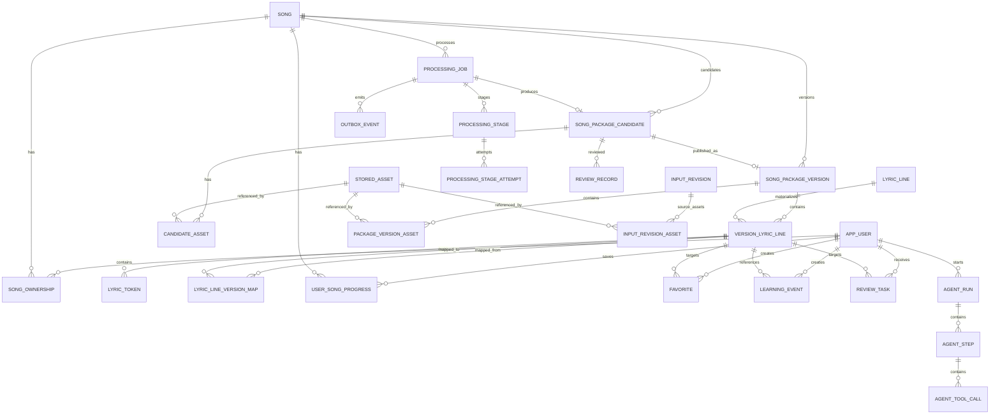

# 数据模型与持久化边界

这是目标 MySQL 模型，不是已执行的迁移。正式实现前先评审首个 Flyway migration 的字段、索引、外键和删除策略，再同步测试数据库结构；不能声称已经验证 MySQL 兼容性。数据库表名使用 `app_user`，避免 `user` 在不同 MySQL 模式下的保留字/兼容性问题。

## 逻辑关系

## 逻辑歌词行与版本歌词行

Sorane 的 `line` 是歌曲包内的播放行，不能直接同时承担跨版本业务身份。因此分成两层：

1. `lyric_line` 是 Utae 的逻辑歌词行，属于一首 `song`，具有 Utae 生成的 `line_key`、可选的规范文本标识和创建/停用时间。它表达“这首歌中的这一逻辑句子”，不直接被播放器消费。
2. `version_lyric_line` 是某个 `song_package_version` 的具体物化行，具有全局唯一 `id`、`version_id`、可空的 `logical_line_id`、`source_line_id`、`line_no`、`start_ms`、`end_ms`、原始 `text`、`translation` 和包内行索引。它是 Manifest、收藏、学习事件和复习任务的直接外键目标。
3. `lyric_token` 属于 `version_lyric_line`，保存当前版本的 `text/kana/romaji` 和可选时间；token 不跨版本共享主键。

`lyric_line.line_key` 在同一歌曲内唯一；`version_lyric_line` 的 `line_no` 在版本内唯一。`source_line_id` 只是上游包内 ID 快照，不假设跨版本稳定。新版本导入后先生成版本行，再通过显式 mapping 决定是否关联同一个 `logical_line_id`。初版为每句建立逻辑 ID；后续只有确认的一对一同句映射沿用逻辑 ID。删除行不在新版本生成对应版本行；拆分、合并或无法可靠对应的句子生成新逻辑 ID，并保留 mapping 作为审计，但不自动迁移收藏/任务。

版本行的时间、原文、分词、罗马音和翻译可以独立修改。旧版本行保持不可变，修改或重新制作只生成新的 `version_lyric_line`。因此播放器永远读取具体版本，业务历史永远知道当时练习的是哪个版本。

## 核心实体

| 表 | 关键字段 | 约束和职责 |
| --- | --- | --- |
| `app_user` | `id`, `role`, `created_at` | 身份和角色；不接受客户端 user scope |
| `song` | `id`, `title`, `artist`, `duration_ms`, `visibility`, `lifecycle_status`, `current_published_version_id`, `deleted_at` | `visibility` 为 `PRIVATE/SHARED`；`lifecycle_status` 为 `ACTIVE/WITHDRAWN/DELETING/DELETED`；当前发布版本 FK 可空 |
| `song_ownership` | `song_id`, `user_id`, `permission`, `created_at` | 所有权唯一事实来源；初期仅 OWNER，唯一 `(song_id,user_id)` |
| `song_package_candidate` | `id`, `song_id`, `job_id`, `schema_version`, `manifest_key`, `sha256`, `result_status`, `review_status` | 私有候选资产；审批前不可见于曲库 |
| `song_package_version` | `id`, `song_id`, `candidate_id`, `package_version`, `schema_version`, `manifest_key`, `source_revision_id`, `sha256`, `published_at` | 只代表已发布不可变业务版本；`schemaVersion` 是格式兼容性，`packageVersion` 是 Utae 版本 |
| `lyric_line` | `id`, `song_id`, `line_key`, `created_at`, `retired_at` | 跨版本逻辑句标识，不直接给播放器引用 |
| `version_lyric_line` | `id`, `version_id`, nullable `logical_line_id`, `source_line_id`, `line_no`, `start_ms`, `end_ms`, `text`, `translation` | 具体版本行；`source_line_id` 是上游包内 ID 快照，`(version_id,line_no)` 唯一 |
| `lyric_token` | `id`, `version_line_id`, `token_no`, `text`, `kana`, `romaji`, `start_ms`, `end_ms` | 版本内视觉 token；不承担跨版本身份 |
| `stored_asset` | `id`, `object_key`, `sha256`, `size_bytes`, `media_type`, `created_at` | 不可变对象记录；object key 不暴露给客户端 |
| `input_revision_asset` | `input_revision_id`, `asset_id`, `role` | 输入修订到原始音频/LRC 的显式关联；每个角色在修订内唯一 |
| `candidate_asset` | `candidate_id`, `asset_id`, `role` | 候选 manifest、音频、分轨、朗读和报告资产关联 |
| `package_version_asset` | `version_id`, `asset_id`, `role` | 已发布不可变版本引用的资产 |
| `input_revision` | `id`, `song_id`, `revision_no`, `audio_sha256`, `lyrics_sha256`, `metadata_sha256`, `provider_config_sha256`, `pipeline_version`, `studio_commit`, `prompt_config_sha256`, `created_at` | 不可变输入快照；一个制作请求引用一个 revision；pipeline/Studio 标识属于输入指纹的一部分 |
| `processing_job` | `id`, `song_id`, `requested_by_user_id`, `input_revision_id`, `pipeline_version`, `studio_commit`, `job_type`, `request_idempotency_key`, `request_hash`, `input_fingerprint`, `status`, `result_status`, `attempt_count`, `lease_token`, nullable `candidate_id` | 每次明确的制作代；版本字段是 revision 的执行身份快照；`result_status` 为 `SUCCESS/PARTIAL_SUCCESS/FAILED`；同请求重试复用 job，输入变化创建新 revision/job |
| `processing_stage` | `id`, `job_id`, `stage`, `status`, `checkpoint`, `artifact_key`, `error_summary` | 当前阶段状态和恢复指针；每次执行的 attempt、fingerprint、产物 hash 和错误摘要存入 `processing_stage_attempt` |
| `processing_stage_attempt` | `id`, `stage_id`, `attempt_no`, `input_fingerprint`, `generation`, `event_intent`, `fencing_token`, `lease_token`, `status`, `artifact_hash`, `checkpoint`, `error_summary`, `started_at`, `finished_at` | 一次实际 Worker 执行；`(stage_id,attempt_no)` 和 `(stage_id,input_fingerprint,generation)` 均唯一；相同 generation 的消息重投复用同一 attempt，新执行意图递增 generation 并分配新的 attempt_no |
| `outbox_event` | `id`, `aggregate_type`, `aggregate_id`, `event_type`, `event_intent`, `generation`, `payload_json`, `dedupe_key`, `status`, `retry_count`, `next_retry_at`, nullable `published_at` | 事务内写入；初次运行和人工复核后的 resume 使用不同 intent/generation；publisher 以 dedupe_key 保护并允许重复发送 |
| `review_record` | `id`, nullable `job_id`, nullable `candidate_id`, `review_kind`, `review_revision`, `reviewer_id`, `decision`, `evidence_key`, `created_at` | 恰有一个 job/candidate 归属；alignment review、playback review 和 publish decision 分开追加记录 |
| `user_song_progress` | `user_id`, `song_id`, `version_id`, nullable `version_line_id`, `last_position_ms`, `updated_at`, `write_sequence` | `(user_id,song_id,version_id)` 唯一；位置范围 `[0,duration_ms]`；旧 sequence 不能覆盖新值 |
| `favorite` | `user_id`, `song_id`, nullable `logical_line_id`, `version_id`, `version_line_id`, `created_at`, `deleted_at` | `(user_id,version_line_id)` 唯一；严格校验行属于指定版本/歌曲 |
| `learning_event` | `id`, `user_id`, `song_id`, nullable `version_id`, nullable `version_line_id`, `event_type`, `event_data`, `created_at` | 只记录播放句子、收藏、完成练习等有意义行为，不记录每次进度 tick |
| `review_task` | `id`, `user_id`, `song_id`, `version_id`, nullable `version_line_id`, `source`, `status`, `reason`, `deleted_at` | 绑定具体版本行；跨版本只能经显式映射迁移 |
| `lyric_line_version_map` | `old_version_line_id`, `new_version_line_id`, `mapping_group_id`, `mapping_kind`, `confidence`, `review_status`, `reviewed_by`, `reviewed_at` | 有方向的版本行映射；`(old_version_line_id,new_version_line_id)` 唯一；`mapping_group_id` 将拆分/合并的多条映射边归为一组 |
| `agent_run` / `agent_step` / `agent_tool_call` | trace 字段、状态、摘要、耗时 | 记录可审计执行过程，不存密钥或完整音频 URL |

`song.owner_id` 不再作为第二套所有权事实；所有权只来自 `song_ownership`。资产通过 `input_revision_asset`、`candidate_asset`、`package_version_asset` 三张有外键的关联表分别归属输入、候选和发布版本，避免多态 nullable 外键。相同哈希的对象可由不同记录引用；物理删除前须确认三个关联范围都没有引用。

## 跨版本继承

`lyric_line_version_map` 的方向固定为旧版本行到新版本行。唯一约束 `(old_version_line_id,new_version_line_id)` 防止重复边；Service 在同一事务中校验两端属于同一歌曲、源版本早于目标版本、映射组的边符合其映射类型，并拒绝同一版本间自映射。`SAME_LINE`/`EDITED_SAME_LINE` 必须是一对一；`SPLIT` 为一个旧行映射多个新行；`MERGED` 为多个旧行映射到一个新行。一个逻辑行对应多行时用相同 `mapping_group_id` 表达。已批准的一对一端点在同一版本转换中不可重复分配；拆分/合并组的基数由事务校验，不把每条边误判为独立的一对一映射。

- 收藏以具体 `version_line_id` 为目标，并记录可选 `logical_line_id`；迁移只创建指向新版本行的新收藏，旧收藏和历史引用不改写。一对一映射通过审核后可向用户提供迁移建议，确认后幂等创建新收藏。一对多映射不把一个收藏复制到所有拆分行，由用户选择目标行；多对一映射不把多个收藏静默合并，由用户确认是否收藏合并后的行。任何映射都不能自动删除旧版本收藏。
- 学习进度按歌曲+版本保存；新版本没有历史进度时可用上一版本的 position 作为恢复建议并 clamp 到新时长，但不得复制旧 `version_line_id`。只有确认的一对一映射后才可映射当前行。
- 学习事件保留发生时的 version/line 引用；不回写成新版本。
- 复习任务绑定具体版本行；旧版本撤回后可标记 `STALE`，由用户或维护者确认后创建新任务。

## 制作输入、任务和候选版本

`input_revision` 对音频、歌词、标题/歌手、Provider 配置、Pipeline 版本、Studio commit 和提示词/契约版本做不可变快照。`metadata_sha256` 覆盖标题/歌手等元数据；版本标识保存为字段并纳入组合后的 `input_fingerprint`，不能只用音频 SHA-256。`processing_job` 冗余保存 `pipeline_version` 和 `studio_commit` 作为执行身份快照，创建时必须与其 revision 一致。

- HTTP `request_idempotency_key` 防止同一上传请求重试创建多个 job；唯一作用域为 `(requested_by_user_id, job_type, request_idempotency_key)`。同 key、同 `request_hash` 返回原 job；同 key、不同 hash 返回冲突，不覆盖原记录。
- `job.id` 代表一次明确的制作代；同 job 的重试增加 `attempt_count`，不创建新业务版本。
- 输入内容、配置或 Studio commit 变化时创建新的 `input_revision` 和 job，即使歌曲相同也不复用旧 checkpoint。
- 候选包有确定性 object key（job、stage、input_fingerprint），数据库对 `(job_id, sha256)` 唯一。候选包与已发布版本是不同实体；Utae 发布审批通过后才创建 `song_package_version` 并更新歌曲的当前发布版本指针。
- MQ 消息携带 job/stage/input_fingerprint/event_intent/generation；同一 generation 的重复投递命中同一 `processing_stage_attempt`，新 retry/resume intent 才递增 generation 和 `attempt_no`。Worker claim 使用 lease/fencing token，旧 worker 的回报被拒收。结果和状态持久化后才 ACK；超过重试上限进入 DLQ/FAILED_FINAL。

## 删除和保留策略

### 私人歌曲删除

1. 事务内将 song 标记 `DELETING` 并立即撤销访问，写删除事件，取消尚未运行的 job；运行中的 job 标记 `CANCEL_REQUESTED` 并递增 fencing 版本，完成回报不能复活歌曲。
2. 进度、收藏和复习任务软删除并从用户查询隐藏。与该私人歌曲关联的 `learning_event` 行整体删除，不保留用户可识别的 song/line 行为明细或聚合计数。
3. 原始音频、候选包、未发布版本和朗读资产立即撤销访问并取消恢复用途；删除 Outbox 触发异步 MinIO 删除，引用计数归零后删除对象，失败持续重试并告警。所有关联清理和删除事件达到终态后才把 song 标记为 `DELETED` tombstone；失败或仍有引用时保持 `DELETING` 并继续重试。用户删除覆盖普通失败任务保留策略。
4. 最小安全审计只保留不可逆的删除操作 ID、时间、actor 的非反查摘要、结果码和对象 hash，不保留 user/song ID、歌词、音频、来源正文或签名 URL；建议保留 180 天后清除。

### 共享歌曲撤回

共享歌曲采用 `WITHDRAWN`/软撤回，不做用户级硬删除。立即从公共曲库和新 Manifest 隐藏；保留其他用户的进度、收藏和学习事件引用，历史界面显示“歌曲已撤回”，并停止生成指向该歌的复习建议。默认保留已发布资产、review/版权来源证据及历史版本；收到需要删除内容的权利/合规要求时，删除受影响的音频/歌词对象并保留不含内容的撤回审计与 tombstone。发布/撤回审计在歌曲仍保留期间持续保存，撤回后建议保留 180 天。

普通的可重试失败任务在未删除歌曲下保留输入和 task directory 30 天供恢复；候选被拒绝后保留候选及 evidence 30 天供复核。期限到达后标记过期并由同一资产清理流程删除；私人歌曲删除会立即覆盖该期限。上述时限为首版产品默认值，正式上线前需在隐私和版权政策中确认。

## 索引和迁移

- `song_ownership(song_id,user_id)` 唯一；`song(current_published_version_id)` 外键可空。
- `song_package_version(song_id,package_version)` 唯一；`lyric_line(song_id,line_key)` 和 `version_lyric_line(version_id,line_no)` 唯一。
- `lyric_line_version_map(old_version_line_id,new_version_line_id)` 唯一；已批准的一对一映射在同一版本转换内要求旧行和新行各只出现一次，拆分/合并边按 `mapping_group_id` 由事务校验。
- `processing_job(requested_by_user_id,job_type,request_idempotency_key)` 唯一，并保存 `request_hash`；`(song_id,input_fingerprint,job_type)` 可用于查重，但不阻止用户明确重新制作。
- `processing_stage(job_id,stage)` 唯一；`processing_stage_attempt(stage_id,attempt_no)` 和 `(stage_id,input_fingerprint,generation)` 均唯一；`outbox_event(dedupe_key)` 唯一。generation 在每个 stage/input fingerprint 范围内递增；初次运行与每次 retry/resume 使用新的 generation，同一 generation 的 MQ 重投仍由 Worker 幂等处理。
- 所有用户历史表按 `(user_id,created_at)` 建索引，进度按 `(user_id,song_id,version_id)` 唯一。

字段、外键、CHECK、保留期和级联规则必须在真实 Flyway migration 与 MySQL 集成测试中确认后，才可更新本文件的“已验证”状态。
